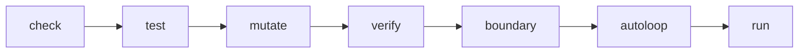

AGENT-L organise la livraison autour de portes distinctes. Chacune répond à une question différente ; aucune ne remplace les autres.



## Les sept portes

| Commande | Question | Travaille sur |
| --- | --- | --- |
| `check` | le programme est-il bien formé ? | AST et références |
| `test` | ses critères d’acceptation tiennent-ils ? | `SCENARIO` |
| `mutate` | chaque règle de politique est-elle défendue par un scénario ? | `SCENARIO` rejoués sur des politiques relâchées |
| `verify` | les propriétés de sûreté sont-elles établies ? | AST et espace d’états borné |
| `boundary` | l’hôte cache-t-il des décisions métier ? | AST Python de `X.py` |
| `autoloop` | où l’agent casse-t-il sur des cas dérivés et retenus ? | source et campagnes |
| `run` | que fait-il contre son hôte réel ? | runtime, hôte et LLM |

## Exécution recommandée

```bash
agentl check agent.agent && \
agentl test agent.agent && \
agentl mutate agent.agent && \
agentl verify agent.agent && \
agentl boundary agent.agent
```

Ne lancez l’exécution réelle qu’après les portes hors ligne :

```bash
agentl run agent.agent --record run.json --html trace.html
```

Pour un agent dont un effet ne doit jamais se produire deux fois (paiement, envoi, suppression), faites aussi le **run de panne durable** : tuez le processus pendant un outil à effet, relancez la même commande, et vérifiez que le monde ne porte l’effet qu’une fois.

```bash
agentl run agent.agent --durable runs/agent      # tuer pendant un outil…
agentl run agent.agent --durable runs/agent      # …puis reprendre
agentl durable status runs/agent                 # relancée, réconciliée ou indéterminée
```

## Bien formé ne veut pas dire sûr

`check` détecte un outil inconnu, un doublon, une référence invalide ou un plan inatteignable. Un programme peut pourtant être parfaitement bien formé et exposer une action dangereuse au LLM, ou n’avoir aucun repli sous un `NEVER`. C’est le rôle de `verify`.

## Tester les règles qui mordent

Un scénario utile force le programme jusqu’au bord de la règle :

```text
SCENARIO critical_asset_is_never_isolated {
    GIVEN {
        asset.criticality = CRITICAL
        threat.status = active
        operator.approval = yes
    }
    EXPECT { threat.status != contained } WITHIN 3
}
```

L’approbation est volontairement présente : le scénario démontre qu’elle ne lève pas le `NEVER`.

## Prouver que la règle mord : `mutate`

Un scénario qui passe dans tous les cas ne teste rien. `agentl mutate` retire tour à tour chaque `NEVER`, `DENY` et `REQUIRE APPROVAL`, puis la garde de chaque `ALLOW … WHEN`, et rejoue tous les scénarios. Un mutant est **tué** si un scénario tombe, **survivant** sinon.

```bash
agentl mutate agent.agent
```

| Code | Sens |
| --- | --- |
| `0` | tout mutant est tué ou levé |
| `1` | au moins une règle n’est défendue par aucun scénario |
| `2` | rien n’est jugeable : aucun scénario, ou scénarios déjà rouges |

Un survivant a trois causes, à examiner dans cet ordre : aucun scénario ne place l’agent dans l’état interdit ; une autre règle fait le même travail (un `NEVER` répété par une règle `DECIDE` devient décoratif) ; ou le mutant est équivalent. Dans ce dernier cas, dites-le au-dessus de la règle :

```text
// MUTATION-OK: DEFAULT DENY couvre déjà ce cas
NEVER purge WHEN dir.protected == yes
```

Une levée sans justification n’est pas lue, et une levée qui ne couvre aucun survivant est signalée.

Pour tester une garde de provenance, posez la valeur non fiable dans le `GIVEN` et faites refuser le validateur :

```text
SCENARIO validator_refuses {
    GIVEN {
        auth.offender_ip = "203.0.113.9" UNTRUSTED
        scenario.refuse.validate_ip = yes
    }
    EXPECT NEVER CALL block_ip
}
```

## Un cliquet pour la dette de sûreté

Dans le dépôt, `tools/check_mutation.py` compare, pour chaque exemple, les règles survivantes à `docs/mutation-baseline.json` et échoue en CI si une règle non défendue **s’ajoute**, ou si un exemple jugé cesse de l’être. Une règle désormais défendue n’échoue pas : le contrôle demande de resserrer la référence (`--write`).

Une règle que le programme ne permet pas d’exercer se **lève avec sa raison** (`// MUTATION-OK:`) plutôt que de recevoir un scénario vide. Un scénario qui passe sans tuer un mutant ne défend rien : le planificateur, par exemple, ignore qu’un outil est refusé.

## Intégration continue minimale

```bash
python3 -m pytest -q

for source in examples/*.agent; do
  agentl check "$source"
  agentl verify "$source"
  agentl test "$source"
  agentl mutate "$source"
done
```

<Warning>
  Un verdict borné n’est pas une preuve complète. Conservez le libellé produit par le vérificateur au lieu de le reformuler en « démontré ».
</Warning>

<Columns cols={2}>
  <Card title="Lire le rapport verify" icon="badge-check" href="/core/verifier">
    Comprenez les théorèmes, contre-exemples et profondeurs.
  </Card>
  <Card title="Durcir la frontière" icon="scan-line" href="/core/boundary">
    Traitez les décisions cachées dans le Python hôte.
  </Card>
</Columns>
